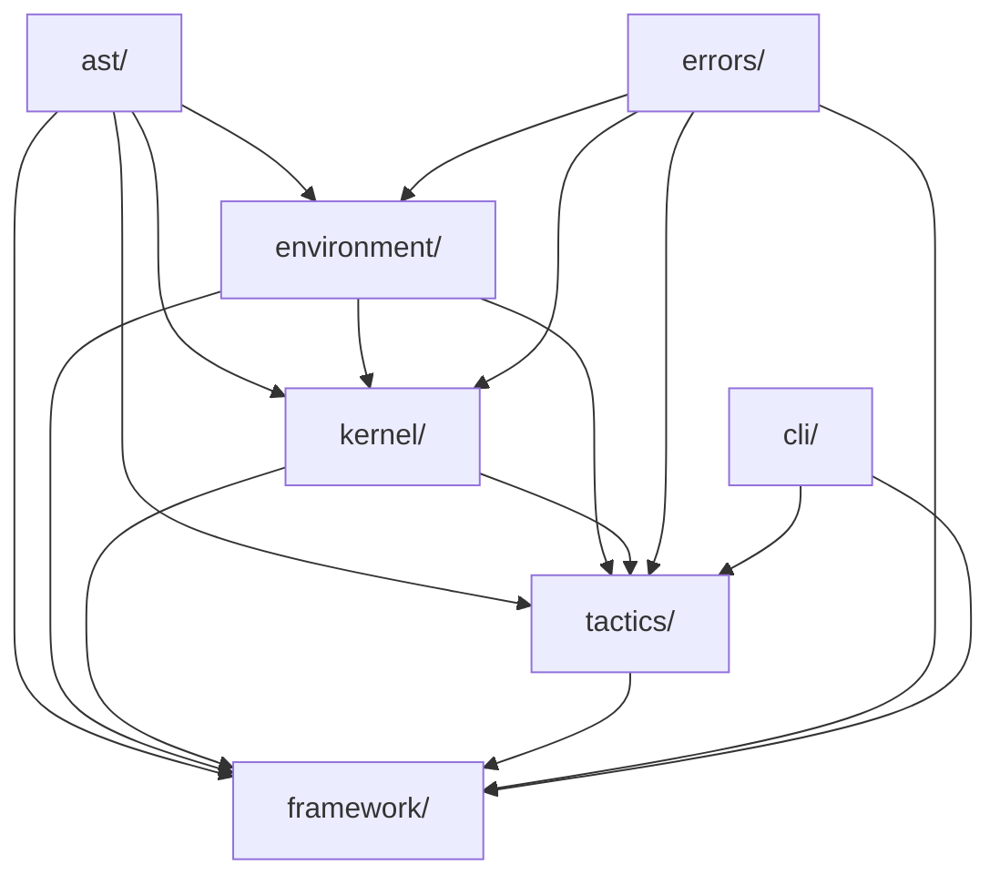
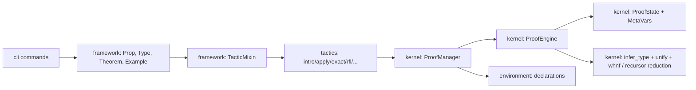

# Developer Guide

This guide explains the internal architecture of poussins and how the major modules interact.

For daily proof writing, see [Proof Author Guide](proof-author-guide.md). For distributed execution or Spark-backed workloads, see the [Integration Docs](integration/README.md).

## Local Setup

```bash
uv sync
uv run pytest
uv run ruff check .
uv run -m poussins --help
```

## Overview

This section gives the high-level structure of the repository and the main architectural boundaries.

### Repository Structure

```text
src/poussins/
  ast/             # Core expression, universe data types, Sort enum, and AST manipulation utilities
  environment/     # Declaration hierarchy and predefined logical environment library (nat, bool, quot, eq, ...)
  kernel/          # Goal state, type checking, unification, recursor reduction (whnf), registration and validation
  tactics/         # User-facing tactical transformations over ProofManager
  framework/       # High-level DSL: Prop, Type, Theorem, Example, TacticMixin, Inductive, Quot, declaration helpers
    inductive_types/ # Concrete inductive wrappers (Nat, Bool, List, Vector, Fin, Prod, Sigma, Sum, Option, Unit, Empty)
    definitions/     # Specialized definition wrappers (Eq)
  cli/             # Command-line entry points and converters
  errors/          # Domain-specific exception hierarchy
example/           # Executable proof scripts (examples 1 through 9, spark verification)
tests/             # Comprehensive unit and integration test suite
```

### Folder Dependency Hierarchy

The package is organized as a directed acyclic dependency graph. Each layer depends on lower layers, but no layer depends back on a higher layer.



In practice:

- `ast/` is the foundation layer. It defines expressions, universe levels, sorts, and traversal/substitution utilities used everywhere.
- `errors/` is a shared support layer. It provides exception types used by the kernel, tactics, framework, and CLI.
- `environment/` builds on `ast/` and defines declarations and library modules for the kernel and framework.
- `kernel/` depends on `ast/`, `environment/`, and `errors/`, and is the core proof-state, type-checking, recursor reduction, and registration/validation engine.
- `tactics/` depends on the kernel and AST concepts to transform goals via `ProofManager`.
- `framework/` builds on kernel, tactics, environment, and AST to provide the user-facing DSL (`Prop`, `Type`, `Theorem`, `Example`, `TacticMixin`, `Quot`, `Inductive`, `inductive_types/`, `definitions/`).
- `cli/` is the top-level command-line entrypoint and depends on the framework and tactics layers.

### Design Principles

- **Pure kernel state transitions**: proof steps produce new immutable `ProofState` snapshots.
- **Thin tactics layer**: tactics orchestrate `ProofManager`, while correctness is strictly enforced by kernel checks.
- **Full computational reduction**: `whnf` in the kernel evaluates definition unfolding, beta reduction, and recursor $\iota$-reduction (e.g. `Nat.rec` execution).
- **Friendly frontend DSL**: `Prop`, `Type`, `Example`, `Theorem`, and `Quot` hide low-level expression trees from users.
- **Explicit environment model**: declarations are validated and registered in `Environment` and referenced by name.
- **Dynamic environment sync**: active goals are refreshed from the latest environment view before each kernel transition.
- **Local/global context split**: goal-local hypotheses are tracked separately from global declarations.

### System Architecture



## Internals

This section explains how proof construction and verification flow through the system.

### End-to-End Proof Flow

1. An `Example` or `Theorem` is initialized with a target expression and `Environment`.
2. `ProofManager` creates an initial goal and metavariable state through `ProofEngine.create_initial_state`.
3. Tactic methods (provided via `TacticMixin`) convert user inputs (`ExprLike`) into AST nodes and invoke tactical functions in `poussins.tactics`.
4. The tactical functions construct proof skeletons and ask `ProofManager` to refine, change, or close goals.
5. The kernel validates typing, unification, and definitional equality via `whnf` (evaluating delta unfolding, beta reductions, and recursor applications).
6. On `Theorem.qed()`, the complete proof term is validated with `validate_theorem` and permanently registered in `Environment` via `register_theorem`. In an `Example.qed()`, the proof term is validated but not registered globally.

### Key Components

#### AST (`ast/`)

- Defines expressions (`EVar`, `EConst`, `EPi`, `EApp`, `ELam`, `EMatch`, `EMetaVar`, `ESort`).
- Defines universe levels (`UnivLevel`, `UnivLevelZero`, `UnivLevelSucc`, `UnivLevelParam`, `UnivLevelMax`, `UnivLevelIMax`).
- Provides `Sort` enum (`Sort.PROP`, `Sort.TYPE`).
- Exposes expression builders and utilities in `ops.py`: `app`, `decompose_app`, `pi`, `lam`, `substitute_var`, `substitute_expr`, `count_pi_binders`, `univ_level`, `univ_levels`, `sort`, `has_metavar`, `collect_metavar_ids`, and `collect_free_vars`.

#### Environment (`environment/`)

- Declaration hierarchy: `AxiomDeclaration`, `DefinitionDeclaration`, `TheoremDeclaration`, `InductiveDeclaration`, `ConstructorDeclaration`, `RecursorDeclaration`, and `QuotientDeclaration`.
- Enum-based predefined library modules under `src/poussins/environment/library/`:
  - `LogicDeclaration`: `True`, `False`, `And`, `Or`, `Not`, `Exists`, and logical recursors.
  - `EqualityDeclaration`: universe-polymorphic equality `Eq.{u}` with `Eq.refl`, `Eq.symm`, `Eq.trans`, and `Eq.rec`.
  - `NatDeclaration`: inductive `Nat` with constructors `Nat.zero`, `Nat.succ`, recursor `Nat.rec`, and recursive arithmetic definitions `Nat.add`, `Nat.sub`, `Nat.mul`, `Nat.div`, and `Nat.mod`.
  - `QuotDeclaration`: quotient primitives `Quot`, `Quot.mk`, `Quot.lift`, `Quot.ind`, and `Quot.sound`.
  - Other core types: `Bool`, `List`, `Vector`, `Fin`, `Prod`, `Sigma`, `Sum`, `Option`, `Unit`, `Empty`.
- `create_standard_environment()`: factory initializing all standard declarations into a fresh `Environment`.

#### Kernel (`kernel/`)

- `ProofState`: immutable snapshot of remaining goals and metavariable assignments.
- `ProofEngine`: executes verified state transitions (`close_goal`, `refine_goal`, `change_goal`, `change_hypothesis`).
- `ProofManager`: stable facade used by tactics and `TacticMixin`.
- `typecheck.py` & `eval.py`:
  - `infer_type`: bidirectional type inference for all expression forms.
  - `whnf`: reduction to weak head normal form. Supports constant unfolding, beta-reduction, match-reduction, and generic **$\iota$-reduction for recursors** (`RecursorDeclaration`). This allows definitions based on recursors (such as `Nat.mod` or `Nat.add`) to compute definitionally during `whnf`, enabling tactics like `rfl()` to close computational equalities automatically.
  - `is_def_eq` / `unify`: definitional equality and higher-order pattern unification.
- `declare.py`:
  - Kernel registration: `register_axiom`, `register_definition`, `register_theorem`, `register_inductive`, `register_quotient`.
  - Kernel validation: `validate_axiom`, `validate_definition`, `validate_theorem`, `validate_inductive`, `validate_quotient`.

#### Tactics (`tactics/`)

- Functional tactic implementations taking `ProofManager` as their first argument.
- Read active goal state, construct proof terms or subgoals, and execute transitions through the manager facade.

#### Framework (`framework/`)

- `TacticMixin`: mixin class supplying method-style tactic invocations (`intro`, `apply`, `exact`, `rfl`, `cases`, `induction`, `rewrite`, etc.) on `Theorem` and `Example`. Transparently converts `ExprLike` (`Expr | Prop | Inductive | str`) arguments to expressions.
- `Prop` & `Type`: high-level AST wrappers with `BindableMixin`. `Prop.forall` and `Prop.exists` accept single items or sequences of bindable objects directly (e.g. `(p, q)` or `(n,)`).
- `Theorem`, `Example`, and aliases (`Lemma`, `Proposition`, `Corollary`, `Fact`, `Remark`, `Property`): proof session objects. `Theorem.qed()` registers the completed theorem, while `Example.qed()` only validates.
- `Inductive`: base class for inductive types, providing `.eq()`, `.type_expr()`, and bindable variable behavior.
- `inductive_types/`: concrete inductive DSL wrappers: `Nat` (with operator overloading `+`, `-`, `*`, `//`, `/`, `%`), `Bool`, `List`, `Vector`, `Fin`, `Prod`, `Sigma`, `Sum`, `Option`, `Unit`, `Empty`.
- `Definition` & `definitions/`: definition wrappers, including `Eq` for declaring equivalence relations.
- `Quot`: quotient type DSL using slice syntax `Quot[rel_def]` to provide `mk`, `sound`, `lift`, `ind`, and `eq`.
- `declaration.py`: high-level declaration helpers (`declare_axiom`, `declare_definition`, `declare_theorem`, `declare_inductive`, `declare_quot`). `declare_inductive` automatically derives and registers the required `RecursorDeclaration` (`.rec`) from constructor signatures.

### CLI Surface

Main entrypoint:

```bash
uv run -m poussins <subcommand>
```

Available subcommands:
- `prove <file>`: batch execution
- `step <file> [--theorem NAME]`: step-wise execution
- `lean2py <file> [--output FILE]`
- `py2lean <file> [--output FILE]`

## Customization

This section explains how to extend the system safely without breaking layering boundaries.

### Extension Points

- Add a new tactic:
  - implement functional logic in `src/poussins/tactics/`
  - expose the method in `src/poussins/framework/tactic_mixin.py`
  - export the functional tactic in `src/poussins/tactics/__init__.py`
  - add focused unit tests under `tests/tactics/`
- Add a new inductive type:
  - register declarations in `Environment` using `declare_inductive`
  - define a user-facing DSL wrapper extending `Inductive`
  - export the wrapper in `src/poussins/framework/inductive_types/` if adding as a built-in library type

#### Public Import Policy

The root package `poussins` is intentionally minimal (`__all__ = []`). Always import from the specific subpackage owning the API:

1. Use `poussins.framework` for proof-authoring DSL objects:
   - `Prop`, `Type`, `Example`, `Theorem` (and aliases)
   - `Axiom`, `Definition`, `Inductive`, `Quot`
   - `create_environment`, `create_standard_environment`
   - `declare_axiom`, `declare_definition`, `declare_theorem`, `declare_inductive`, `declare_quot`
2. Use `poussins.framework.inductive_types` for built-in inductive types:
   - `Nat`, `Bool`, `List`, `Vector`, `Fin`, `Prod`, `Sigma`, `Sum`, `Option`, `Unit`, `Empty`
3. Use `poussins.framework.definitions` for predefined definition helpers:
   - `Eq`
4. Use `poussins.environment` for environment and declaration data types (`Environment`, `AxiomDeclaration`, etc.).
5. Use `poussins.tactics` for functional tactic functions.
6. Use `poussins.ast` and `poussins.kernel` for low-level expressions, sorts, unification, and kernel registration/validation.

#### Adding A New Inductive Type

To define a new inductive type, perform the following two steps:

##### Step 1: Register Declarations with `declare_inductive`

Call `declare_inductive(env, name, type, constructors, level_params=())` to register the type in the `Environment`. 

`declare_inductive` automatically:
- Creates the `InductiveDeclaration`.
- Creates `ConstructorDeclaration` instances for each constructor.
- Derives and validates the recursor (`<name>.rec`), computing the motive type, induction parameters, minor premises, and inductive hypotheses.
- Registers all declarations into `env` in one atomic operation.

```python
from poussins.ast import EConst, EPi, Sort
from poussins.framework import declare_inductive, create_standard_environment

env = create_standard_environment()

# Define an inductive type, e.g. Color with two nullary constructors
declare_inductive(
    env=env,
    name="Color",
    type=Sort.TYPE.sort,
    constructors=[
        ("Color.red", EConst("Color", ())),
        ("Color.blue", EConst("Color", ())),
    ],
)
```

For recursive types (e.g., custom natural numbers or trees), specify recursive constructor signatures using `EPi`:

```python
my_nat_type = EConst("MyNat", ())
declare_inductive(
    env=env,
    name="MyNat",
    type=Sort.TYPE.sort,
    constructors=[
        ("MyNat.zero", my_nat_type),
        ("MyNat.succ", EPi("n", my_nat_type, my_nat_type)),
    ],
)
```

##### Step 2: Create a DSL Wrapper Class Extending `Inductive`

Extend `Inductive` to give proof authors an ergonomic Python interface:
- Inherit from `Inductive` (`BindableMixin` is automatically inherited, enabling variable binding in quantifiers).
- Set `TYPE_NAME: ClassVar[str]` and `LEVEL_PARAMS: ClassVar[tuple[str, ...]]`.
- Define `@classmethod` constructors returning instances wrapped in `cls(...)`.
- `Inductive` automatically provides `.eq(left, right)`, `.type_expr()`, `.levels()`, and `.sort()`.

```python
from dataclasses import dataclass
from typing import ClassVar
from poussins.ast import EConst, EApp, Expr
from poussins.framework import Inductive

@dataclass(frozen=True, init=False)
class Color(Inductive):
    """DSL wrapper for the Color inductive type."""

    TYPE_NAME: ClassVar[str] = "Color"
    LEVEL_PARAMS: ClassVar[tuple[str, ...]] = ()

    @classmethod
    def red(cls) -> Color:
        return cls(EConst("Color.red", levels=cls.levels()))

    @classmethod
    def blue(cls) -> Color:
        return cls(EConst("Color.blue", levels=cls.levels()))


@dataclass(frozen=True, init=False)
class MyNat(Inductive):
    """DSL wrapper for recursive MyNat inductive type."""

    TYPE_NAME: ClassVar[str] = "MyNat"
    LEVEL_PARAMS: ClassVar[tuple[str, ...]] = ()

    @classmethod
    def zero(cls) -> MyNat:
        return cls(EConst("MyNat.zero", levels=cls.levels()))

    @classmethod
    def succ(cls, n: MyNat | Expr) -> MyNat:
        return cls(EApp(EConst("MyNat.succ", levels=cls.levels()), cls.to_expr(n)))
```

##### Step 3: Using the New Inductive Type in Proofs

The wrapper class works immediately with tactics such as `cases`, `induction`, and quantifiers:

```python
from poussins.framework import Example, Prop

# Case analysis on Color
c = Color("c")
ex_color = Example(Prop.forall((c,), Color.eq(c, c)), env)
ex_color.intro("c")
ex_color.cases("c")
ex_color.rfl()
ex_color.rfl()
ex_color.qed()

# Induction on MyNat (uses automatically derived MyNat.rec)
n = MyNat("n")
ex_nat = Example(Prop.forall((n,), MyNat.eq(n, n)), env)
ex_nat.intro("n")
ex_nat.induction("n")  # generates zero base case and succ inductive step with hypothesis
ex_nat.rfl()
ex_nat.rfl()
ex_nat.qed()
```

If the type is intended as a permanent library type:
- Place the wrapper under `src/poussins/framework/inductive_types/<name>.py`.
- Re-export it from `src/poussins/framework/inductive_types/__init__.py`.
- Pre-register it in `create_standard_environment()` or an enum in `src/poussins/environment/library/`.

#### Tactic Implementation Rules

Tactics are thin adapters over `ProofManager`. Keep them narrow and do not move proof-state ownership out of the kernel facade.

1. A tactic function must take `ProofManager` as its first argument.
2. Use `ProofManager` operations such as `close_goal()`, `refine_goal()`, `change_goal()`, `change_hypothesis()`, and `undo()` to mutate proof state.
3. Inspect current goals via `manager.current_state` when computing the next step.
4. Do not mutate `ProofSession`, `ProofState`, goal lists, or metavariable tables directly.
5. Raise domain-specific errors (`TacticError`) with informative messages when a tactic cannot proceed.
6. Add the corresponding fluent wrapper method to `src/poussins/framework/tactic_mixin.py` decorated with `@log_tactic`.
7. Export the tactic function from `src/poussins/tactics/__init__.py`.
8. Add comprehensive positive and negative unit tests under `tests/tactics/`.

### Quality Checklist For Changes

- New/changed tactic has positive and negative tests.
- Error messages are specific (`TacticError`, `Kernel*Error`, `FrameworkError`).
- Examples still run with `uv run python example/...`.
- `uv run pytest` and `uv run ruff check .` pass cleanly.

## Common Commands

```bash
# CLI
uv run -m poussins prove path/to/proofs.py

# Tests and lint
uv run pytest
uv run ruff check src

# Package
uv build
uv publish
```

---

Back to [README](../README.md).
