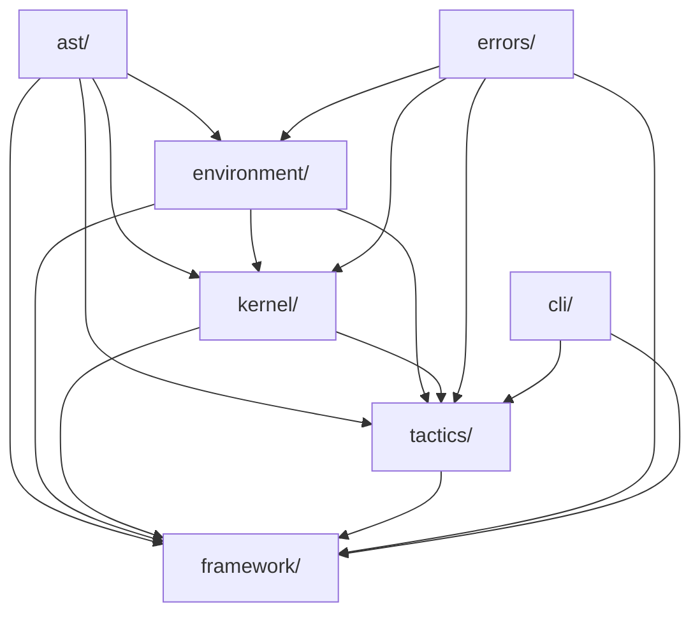
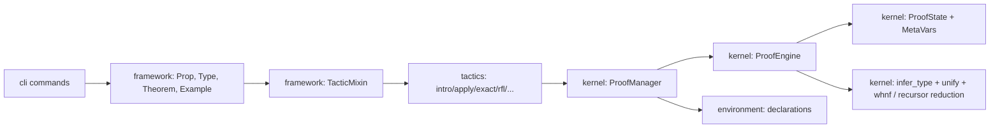

# Developer Guide

This guide explains the internal architecture of poussins and how the major modules interact.

For daily proof writing, see [Proof Author Guide](proof-author-guide.md). For distributed execution or Spark-backed workloads, see the [Integration Docs](integration/README.md).

## Local Setup

```bash
uv sync
uv run pytest
uv run ruff check .
uv run -m poussins --help
```

## Overview

This section gives the high-level structure of the repository and the main architectural boundaries.

### Repository Structure

```text
src/poussins/
  ast/             # Core expression (EFVar, EBVar, EConst, ...), universe data types, Sort enum (sorts.py), and AST manipulation utilities (ops.py)
  environment/     # Declaration hierarchy, specifications (AxiomSpec, DefinitionSpec, TheoremSpec, InductiveSpec), ops (const), and predefined library specs (nat, bool, quot, eq, ...)
  kernel/          # Goal state, type checking, unification, recursor reduction (whnf), registration and validation
  tactics/         # User-facing tactical transformations over ProofManager
  framework/       # High-level DSL: Prop, Type, Theorem, Example, TacticMixin, Inductive, Quot, bound_var utilities, declaration helpers
    inductive_types/ # Concrete inductive wrappers (Nat, Bool, List, Vector, Fin, Prod, Sigma, Sum, Option, Unit, Empty)
    definitions/     # Specialized definition wrappers (Eq)
  cli/             # Command-line entry points and converters
  errors/          # Domain-specific exception hierarchy
example/           # Executable proof scripts (examples 1 through 9, spark verification)
tests/             # Comprehensive unit and integration test suite
```

### Folder Dependency Hierarchy

The package is organized as a directed acyclic dependency graph. Each layer depends on lower layers, but no layer depends back on a higher layer.



In practice:

- `ast/` is the foundation layer. It defines expressions, universe levels, sorts, and traversal/substitution utilities used everywhere.
- `errors/` is a shared support layer. It provides exception types used by the kernel, tactics, framework, and CLI.
- `environment/` builds on `ast/` and defines declarations, specifications (`Spec`), and library modules for the kernel and framework.
- `kernel/` depends on `ast/`, `environment/`, and `errors/`, and is the core proof-state, type-checking, recursor reduction, and registration/validation engine.
- `tactics/` depends on the kernel and AST concepts to transform goals via `ProofManager`.
- `framework/` builds on kernel, tactics, environment, and AST to provide the user-facing DSL (`Prop`, `Type`, `Theorem`, `Example`, `TacticMixin`, `Quot`, `Inductive`, `inductive_types/`, `definitions/`).
- `cli/` is the top-level command-line entrypoint and depends on the framework and tactics layers.

### Design Principles

- **Pure kernel state transitions**: proof steps produce new immutable `ProofState` snapshots.
- **Thin tactics layer**: tactics orchestrate `ProofManager`, while correctness is strictly enforced by kernel checks.
- **Full computational reduction**: `whnf` in the kernel evaluates definition unfolding, beta reduction, and recursor $\iota$-reduction (e.g. `Nat.rec` and `Nat.casesOn` execution).
- **Friendly frontend DSL**: `Prop`, `Type`, `Example`, `Theorem`, and `Quot` hide low-level expression trees from users.
- **Explicit environment model**: declarations are validated and registered in `Environment` and referenced by name.
- **Dynamic environment sync**: active goals are refreshed from the latest environment view before each kernel transition.
- **Local/global context split**: goal-local hypotheses are tracked separately from global declarations.

### System Architecture



## Internals

This section explains how proof construction and verification flow through the system.

### End-to-End Proof Flow

1. An `Example` or `Theorem` is initialized with a target expression and `Environment`.
2. `ProofManager` creates an initial goal and metavariable state through `ProofEngine.create_initial_state`.
3. Tactic methods (provided via `TacticMixin`) convert user inputs (`ExprLike`) into AST nodes and invoke tactical functions in `poussins.tactics`.
4. The tactical functions construct proof skeletons and ask `ProofManager` to refine, change, or close goals.
5. The kernel validates typing, unification, and definitional equality via `whnf` (evaluating delta unfolding, beta reductions, and recursor applications).
6. On `Theorem.qed()`, the complete proof term is validated and permanently registered in `Environment` via `declare_theorem` (wrapping kernel `register_theorem`). In an `Example.qed()`, the proof term is verified against an isolated copy of the environment without polluting the caller's global environment.

### Key Components

#### AST (`ast/`)

- Defines expressions:
  - `EFVar`: Free variable, identified by name (e.g. `x`, `y`).
  - `EBVar`: Bound variable represented by de Bruijn index (e.g. `#0`, `#1`).
  - `EConst`: Constant declaration reference with universe levels (e.g. `Nat`, `Eq.refl`).
  - `EPi`: Dependent function type ($\Pi x : A, B$).
  - `ELam`: Lambda abstraction ($\lambda x : A, t$).
  - `EApp`: Function application ($f\ a$).
  - `EMetaVar`: Metavariable standing for an unproven goal.
  - `ESort`: Sort universe (`Prop` or `Type u`).
  *(Note: pattern matching expression `EMatch` was removed; case analysis and pattern reduction are evaluated via recursors and derived `.casesOn` definitions).*
- Defines universe levels (`UnivLevel`, `UnivLevelZero`, `UnivLevelSucc`, `UnivLevelParam`, `UnivLevelMax`, `UnivLevelIMax`).
- Provides `Sort` enum in `sorts.py` (`Sort.PROP`, `Sort.TYPE`).
- Exposes expression builders and utilities in `ops.py`:
  - `app`: builds left-associated application chains. Accepts `Expr | str` (strings are converted to `EFVar`).
  - `lam`: builds nested lambda abstractions from `(name, domain)` binders and automatically abstracts variable occurrences into de Bruijn indices (`EBVar`).
  - `pi`: builds nested Pi types from `(name, domain)` binders and automatically abstracts variable occurrences into de Bruijn indices (`EBVar`).
  - `decompose_app`: decomposes application chain into head and arguments.
  - `shift_bvars`, `substitute_bvar`, `substitute_bvar_top`, `instantiate_binder`: de Bruijn index operations.
  - `substitute_var`, `substitute_expr`: variable and subexpression substitution.
  - `count_pi_binders`: counts Pi binders (arity).
  - `univ_level`, `univ_levels`, `sort`: universe level and sort builders.
  - `has_metavar`, `collect_metavar_ids`: metavariable inspection.
  - `collect_univ_level_params`: collects universe level parameter names from expressions.
  - `collect_free_vars`: collects free variable names (`EFVar`).

#### Environment (`environment/`)

- Declaration hierarchy: `AxiomDeclaration`, `DefinitionDeclaration`, `TheoremDeclaration`, `InductiveDeclaration`, `ConstructorDeclaration`, `RecursorDeclaration`, and `QuotientDeclaration`.
- Declaration specifications under `src/poussins/environment/spec.py`:
  - `AxiomSpec`: specification for an axiom (`name`, `statement`).
  - `DefinitionSpec`: specification for a definition (`name`, `type`, `value`).
  - `TheoremSpec`: specification for a theorem (`name`, `statement`, `term`).
  - `InductiveSpec`: specification for an inductive type (`name`, `type`, `constructors`).
- Predefined library specifications under `src/poussins/environment/library/`:
  - `EQ_IND_SPEC`, `EQ_SYMM_DEF_SPEC`, `EQ_TRANS_DEF_SPEC`: universe-polymorphic equality `Eq.{u}` with symmetry and transitivity definitions.
  - `TRUE_IND_SPEC`, `FALSE_IND_SPEC`, `AND_IND_SPEC`, `OR_IND_SPEC`, `NOT_DEF_SPEC`, `EXISTS_IND_SPEC`: standard logical connectives and quantifiers.
  - `NAT_IND_SPEC`, `NAT_ADD_DEF_SPEC`, `NAT_SUB_DEF_SPEC`, `NAT_MUL_DEF_SPEC`, `NAT_DIV_DEF_SPEC`, `NAT_MOD_DEF_SPEC`: inductive `Nat` and recursive arithmetic definitions.
  - `QUOT_DECLARATION`, `QUOT_MK_DECLARATION`, `QUOT_LIFT_DECLARATION`, `QUOT_IND_DECLARATION`, `QUOT_SOUND_DECLARATION`: quotient primitives.
  - Other core inductive specifications: `BOOL_IND_SPEC`, `EMPTY_IND_SPEC`, `UNIT_IND_SPEC`, `LIST_IND_SPEC`, `VECTOR_IND_SPEC`, `FIN_IND_SPEC`, `PROD_IND_SPEC`, `SIGMA_IND_SPEC`, `SUM_IND_SPEC`, `OPTION_IND_SPEC`.
- Environment operations:
  - `const(env, name)`: creates `EConst` with universe levels automatically populated from the declaration registered in `env`.
- `create_standard_environment()`: factory initializing all standard inductive types, definitions, and quotient declarations into a fresh `Environment`.

#### Kernel (`kernel/`)

- `ProofState`: immutable snapshot of remaining goals and metavariable assignments.
- `ProofEngine`: executes verified state transitions (`close_goal`, `refine_goal`, `change_goal`, `change_hypothesis`).
- `ProofManager`: stable facade used by tactics and `TacticMixin`.
- `typecheck.py` & `eval.py`:
  - `infer_type`: bidirectional type inference for all expression forms.
  - `whnf`: reduction to weak head normal form. Supports constant unfolding, beta-reduction, and generic **$\iota$-reduction for recursors** (`RecursorDeclaration`). This allows definitions based on recursors (such as `Nat.mod` or `Nat.add`) to compute definitionally during `whnf`, enabling tactics like `rfl()` to close computational equalities automatically.
  - `is_def_eq` / `unify`: definitional equality and higher-order pattern unification.
- `declare.py`:
  - Kernel registration: `register_axiom`, `register_definition`, `register_theorem`, `register_inductive`, `register_quotient`.
  - Kernel validation: `validate_axiom`, `validate_definition`, `validate_theorem`, `validate_inductive`, `validate_quotient`.

#### Tactics (`tactics/`)

- Functional tactic implementations taking `ProofManager` as their first argument.
- Read active goal state, construct proof terms or subgoals, and execute transitions through the manager facade.

#### Framework (`framework/`)

- `TacticMixin`: mixin class supplying method-style tactic invocations (`intro`, `apply`, `exact`, `rfl`, `cases`, `induction`, `rewrite`, etc.) on `Theorem` and `Example`. Transparently converts `ExprLike` (`Expr | Prop | Inductive | str`) arguments to expressions.
- `bound_var.py`: infrastructure for bound variables in quantifiers and binders:
  - `BoundVar = tuple[str, Expr]`
  - `BoundVarLike = Sequence[BoundVar | BindableMixin] | BoundVar | BindableMixin`
  - `normalize_bound_vars`: normalizes bound variable inputs into sequence of `(name, type)` tuples.
  - `abstract_over_bound_vars`: abstracts free variables into de Bruijn bound variables.
  - `instantiate_binder_body`: substitutes de Bruijn indices with argument expressions.
  - `BindableMixin`: mixin for bindable DSL objects, providing `.bound_type`, `.bound_value`, `.name`, and `.to_bound_var()`.
- `Prop` & `Type`: high-level AST wrappers with `BindableMixin`. `Prop.forall` and `Prop.exists` accept single items or sequences of bindable objects directly (e.g. `(p, q)` or `(n,)`).
- `Theorem`, `Example`, and aliases (`Lemma`, `Proposition`, `Corollary`, `Fact`, `Remark`, `Property`): proof session objects. `Theorem.qed()` registers the completed theorem in `env`, while `Example.qed()` validates without polluting the caller's environment.
- `Inductive`: base class for inductive types, providing `.eq(left, right)`, `.type_ref()`, `.type`, `.env()`, and bound variable behavior via `BindableMixin`.
- `inductive_types/`: concrete inductive DSL wrappers: `Nat` (with operator overloading `+`, `-`, `*`, `//`, `/`, `%`), `Bool`, `List`, `Vector`, `Fin`, `Prod`, `Sigma`, `Sum`, `Option`, `Unit`, `Empty`.
- `Definition` & `definitions/`: definition wrappers, including `Eq` for declaring equivalence relations (`Eq(name, bound_vars, type_a, left, right)` with `.declare(env)`).
- `Axiom`: axiom wrapper (`Axiom(name, statement)` with `.declare(env)`).
- `Quot`: quotient type DSL using slice syntax `Quot[rel_def]` to provide `mk`, `sound`, `lift`, `ind`, and `eq`.
- `declaration.py`: high-level declaration helpers:
  - `declare_inductive(env, spec: InductiveSpec) -> InductiveDeclaration`: automatically derives and registers the required `RecursorDeclaration` (`.rec`) and `casesOn` eliminator (`.casesOn`) from constructor signatures.
  - `declare_definition(env, spec: DefinitionSpec) -> DefinitionDeclaration`
  - `declare_axiom(env, spec: AxiomSpec) -> AxiomDeclaration`
  - `declare_theorem(env, spec: TheoremSpec) -> TheoremDeclaration`
  - `declare_quot(env) -> QuotientDeclaration`

### CLI Surface

Main entrypoint:

```bash
uv run -m poussins <subcommand>
```

Available subcommands:
- `prove <file>`: batch execution
- `step <file> [--theorem NAME]`: step-wise execution
- `lean2py <file> [--output FILE]`
- `py2lean <file> [--output FILE]`

## Customization

This section explains how to extend the system safely without breaking layering boundaries.

### Extension Points

- Add a new tactic:
  - implement functional logic in `src/poussins/tactics/`
  - expose the method in `src/poussins/framework/tactic_mixin.py`
  - export the functional tactic in `src/poussins/tactics/__init__.py`
  - add focused unit tests under `tests/tactics/`
- Add a new inductive type:
  - define an `InductiveSpec` and decorate an `Inductive` subclass with `@inductive_type(spec)`
  - register declarations into `Environment` with `MyType.declare(env)`
  - export the wrapper in `src/poussins/framework/inductive_types/` if adding as a built-in library type

#### Public Import Policy

The root package `poussins` is intentionally minimal (`__all__ = []`). Always import from the specific subpackage owning the API:

1. Use `poussins.framework` for proof-authoring DSL objects:
   - `Prop`, `Type`, `Example`, `Theorem` (and aliases)
   - `Axiom`, `Definition`, `Inductive`, `Quot`
   - `create_environment`, `create_standard_environment`
   - `declare_axiom`, `declare_definition`, `declare_theorem`, `declare_inductive`, `declare_quot`
2. Use `poussins.framework.inductive` for the `Inductive` base class and `@inductive_type` decorator.
3. Use `poussins.framework.inductive_types` for built-in inductive types:
   - `Nat`, `Bool`, `List`, `Vector`, `Fin`, `Prod`, `Sigma`, `Sum`, `Option`, `Unit`, `Empty`
4. Use `poussins.framework.definitions` for predefined definition helpers:
   - `Eq`
5. Use `poussins.environment` for environment, declarations, specifications, and operations:
   - `Environment`, `AxiomDeclaration`, `DefinitionDeclaration`, `TheoremDeclaration`, `InductiveDeclaration`, `ConstructorDeclaration`, `RecursorDeclaration`, `QuotientDeclaration`
   - `AxiomSpec`, `DefinitionSpec`, `TheoremSpec`, `InductiveSpec`
   - `const`
6. Use `poussins.tactics` for functional tactic functions.
7. Use `poussins.ast` and `poussins.kernel` for low-level expressions, sorts, unification, and kernel registration/validation.

#### Adding A New Inductive Type

To define a new inductive type, perform the following steps:

##### Step 1: Define the Specification (`InductiveSpec`)

Specify the inductive type name, sort type, and constructor signatures using an `InductiveSpec`.

For non-recursive types (e.g. `Color` with nullary constructors):
```python
from poussins.ast import EConst, Sort
from poussins.environment import InductiveSpec

color_type = EConst("Color", ())
color_spec = InductiveSpec(
    name="Color",
    type=Sort.TYPE.sort,
    constructors=(
        ("Color.red", color_type),
        ("Color.blue", color_type),
    ),
)
```

For recursive types (e.g., custom natural numbers or trees), specify recursive constructor signatures using `pi`:
```python
from poussins.ast import EConst, Sort, pi
from poussins.environment import InductiveSpec

my_nat_type = EConst("MyNat", ())
my_nat_spec = InductiveSpec(
    name="MyNat",
    type=Sort.TYPE.sort,
    constructors=(
        ("MyNat.zero", my_nat_type),
        ("MyNat.succ", pi((("n", my_nat_type),), my_nat_type)),
    ),
)
```

##### Step 2: Create a DSL Wrapper Class Decorated with `@inductive_type`

Extend `Inductive` and decorate with `@inductive_type(spec=...)`:
- Inherits `BindableMixin` automatically, enabling bound variable semantics in quantifiers.
- The decorator sets `NAME`, `TYPE`, and `CONSTRUCTORS` from the specification.
- Implement `.declare(env)` to register the specification and associate `env` with the class.
- Define `@classmethod` constructors returning instances wrapped in `cls(...)`.
- `Inductive` automatically provides `.eq(left, right)`, `.type_ref()`, `.type`, and bound variable behavior.

```python
from dataclasses import dataclass
from typing import ClassVar
from poussins.ast import Expr, app
from poussins.environment import Environment, InductiveDeclaration, const
from poussins.framework import Inductive, declare_inductive
from poussins.framework.inductive import inductive_type

@dataclass(frozen=True, init=False)
@inductive_type(spec=color_spec)
class Color(Inductive):
    """DSL wrapper for the Color inductive type."""

    RED_IDX: ClassVar[int] = 0
    BLUE_IDX: ClassVar[int] = 1

    @classmethod
    def declare(cls, env: Environment) -> InductiveDeclaration:
        decl = declare_inductive(env, color_spec)
        cls._env = env
        return decl

    @classmethod
    def red(cls) -> Color:
        env = cls.env()
        return cls(const(env=env, name=cls.CONSTRUCTORS[cls.RED_IDX][0]))

    @classmethod
    def blue(cls) -> Color:
        env = cls.env()
        return cls(const(env=env, name=cls.CONSTRUCTORS[cls.BLUE_IDX][0]))


@dataclass(frozen=True, init=False)
@inductive_type(spec=my_nat_spec)
class MyNat(Inductive):
    """DSL wrapper for recursive MyNat inductive type."""

    ZERO_IDX: ClassVar[int] = 0
    SUCC_IDX: ClassVar[int] = 1

    @classmethod
    def declare(cls, env: Environment) -> InductiveDeclaration:
        decl = declare_inductive(env, my_nat_spec)
        cls._env = env
        return decl

    @classmethod
    def zero(cls) -> MyNat:
        env = cls.env()
        return cls(const(env=env, name=cls.CONSTRUCTORS[cls.ZERO_IDX][0]))

    @classmethod
    def succ(cls, n: MyNat | Expr) -> MyNat:
        env = cls.env()
        return cls(app(const(env=env, name=cls.CONSTRUCTORS[cls.SUCC_IDX][0]), cls.to_expr(n)))
```

##### Step 3: Register in the Environment with `.declare(env)`

Call `.declare(env)` on the class. This automatically:
- Registers the `InductiveDeclaration` and all `ConstructorDeclaration` instances into `env`.
- Derives and registers the recursor (`<name>.rec`) and the `.casesOn` eliminator definition into `env`.
- Sets `cls._env = env` so that `cls.env()` resolves the environment.

```python
from poussins.framework import create_standard_environment

env = create_standard_environment()
Color.declare(env)
MyNat.declare(env)
```

##### Step 4: Using the New Inductive Type in Proofs

The wrapper class works immediately with tactics such as `cases`, `induction`, and quantifiers:

```python
from poussins.framework import Example, Prop

# Case analysis on Color
c = Color("c")
ex_color = Example(Prop.forall((c,), Color.eq(c, c)), env)
ex_color.intro("c")
ex_color.cases("c")
ex_color.rfl()
ex_color.rfl()
ex_color.qed()

# Induction on MyNat (uses automatically derived MyNat.rec)
n = MyNat("n")
ex_nat = Example(Prop.forall((n,), MyNat.eq(n, n)), env)
ex_nat.intro("n")
ex_nat.induction("n")  # generates zero base case and succ inductive step with hypothesis
ex_nat.rfl()
ex_nat.rfl()
ex_nat.qed()
```

If the type is intended as a permanent library type:
- Define the specification under `src/poussins/environment/library/<name>.py`.
- Re-export it from `src/poussins/environment/library/__init__.py`.
- Pre-register it in `create_standard_environment()` in `src/poussins/framework/environment.py`.
- Place the wrapper under `src/poussins/framework/inductive_types/<name>.py` and re-export it from `src/poussins/framework/inductive_types/__init__.py`.

#### Tactic Implementation Rules

Tactics are thin adapters over `ProofManager`. Keep them narrow and do not move proof-state ownership out of the kernel facade.

1. A tactic function must take `ProofManager` as its first argument.
2. Use `ProofManager` operations such as `close_goal()`, `refine_goal()`, `change_goal()`, `change_hypothesis()`, and `undo()` to mutate proof state.
3. Inspect current goals via `manager.current_state` when computing the next step.
4. Do not mutate `ProofSession`, `ProofState`, goal lists, or metavariable tables directly.
5. Raise domain-specific errors (`TacticError`) with informative messages when a tactic cannot proceed.
6. Add the corresponding fluent wrapper method to `src/poussins/framework/tactic_mixin.py` decorated with `@log_tactic`.
7. Export the tactic function from `src/poussins/tactics/__init__.py`.
8. Add comprehensive positive and negative unit tests under `tests/tactics/`.

### Quality Checklist For Changes

- New/changed tactic has positive and negative tests.
- Error messages are specific (`TacticError`, `Kernel*Error`, `FrameworkError`).
- Examples still run with `uv run python example/...`.
- `uv run pytest` and `uv run ruff check .` pass cleanly.

## Common Commands

```bash
# CLI
uv run -m poussins prove path/to/proofs.py

# Tests and lint
uv run pytest
uv run ruff check src

# Package
uv build
uv publish
```

---

Back to [README](../README.md).
